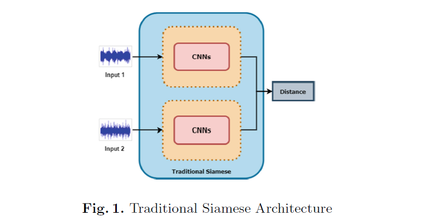
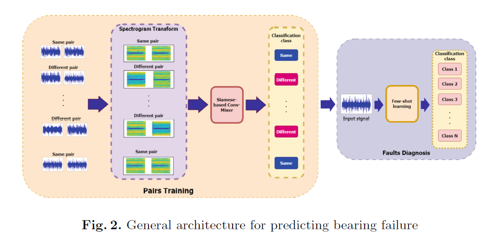
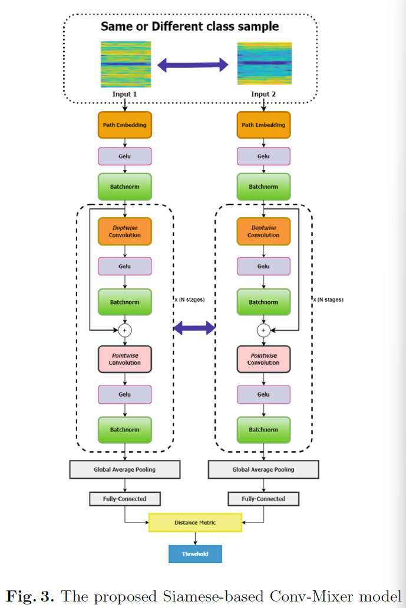
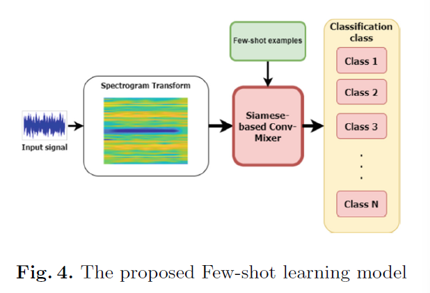
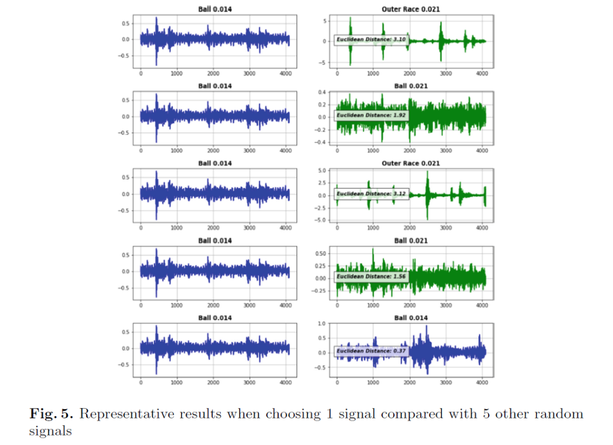
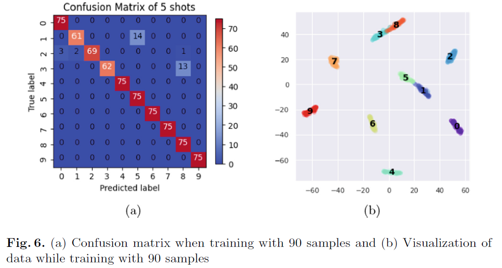
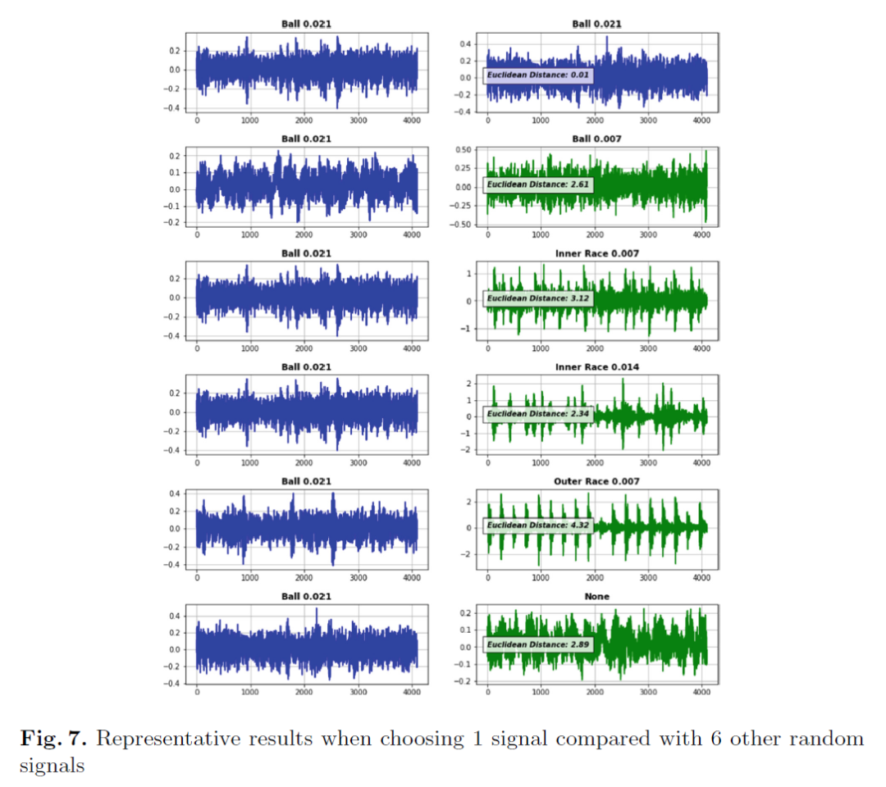
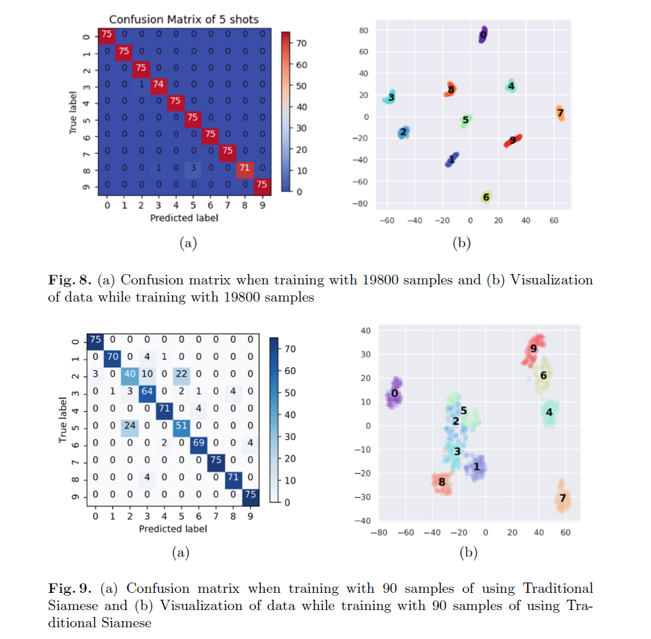

# [Fault Diagnosis] Few-Sample Breakthrough! A New Method for Bearing Fault Diagnosis Based on ConvMixer, with Accuracy of 95.48%+ [Attached Python Code]

Personal Blog: https://www.cnblogs.com/EWFrontier
✿Rare-sample breakthrough! A new method for bearing fault diagnosis based on ConvMixer, with an accuracy rate of 95.48%+
2. Summary According to reports, nearly 40% of motor failures are caused by bearing issues, making bearing fault identification crucial. Deep learning techniques such as WDCNN, ConvMixer, and twin network models have been widely applied in bearing fault diagnosis, but efficient diagnosis often requires a large amount of training data. To address this issue, this paper proposes a new method that significantly improves training performance under small datasets: integrating the ConvMixer model into the backbone network of a twin network, combined with few-shot learning, achieving precise classification with limited training data. Based on the publicly available dataset from Case Western Reserve University (CWRU), multiple experiments were conducted using both raw signals and signal spectra as inputs, and compared with traditional models. The results show that this method significantly improves performance in small dataset scenarios—achieving an accuracy of 95.48% with only 90 training samples, while existing traditional models all have an accuracy below 92%; moreover, this method has been verified to perform stably across various training sample sizes after spectrum transformation and without it.
3. Introduction to bearing fault diagnosis refers to the process of identifying and detecting faults or weak points in bearings. If these defects are not timely discovered and repaired, it may lead to the decline of equipment performance, increased vibration, or even triggering a complete failure of the machine. Research has shown that vibration analysis, acoustic emission analysis, and motor current signal analysis are commonly used for bearing fault diagnosis. These methods can reflect the operating status of the bearing and assist in identifying specific fault types such as inner ring failure, outer ring failure, ball failure, and roller failure.
In the past, traditional machine learning techniques such as Support Vector Machine (SVM), K-Nearest Neighbors (KNN), and Artificial Neural Networks (ANN) were used for fault detection in rolling bearings. However, these methods share common limitations: they require a deep understanding of signal characteristics and fault characteristics, and are difficult to identify faults when there is interference, or to analyze the differences in characteristic features of different faults.
To overcome the limitations of traditional machine learning and further enhance diagnostic accuracy, the application of deep learning neural networks has become increasingly widespread. Recurrent Neural Networks (RNN), Autoencoders (AE), Convolutional Neural Networks (CNN), deep learning-based transfer learning, and Deep Belief Networks (DBN) have demonstrated exceptional performance in fault diagnosis. For example, some studies have employed a 5-layer autoencoder to extract features from frequency domain fault signals, or fused time-domain and frequency-domain features through a dual-layer sparse autoencoder before inputting into a DBN for classification; by 2015, RNN had been applied to bearing fault diagnosis, followed by the emergence of models based on raw time-varying signals such as Trained Imbalanced CNN (TICNN), LeNet-5 CNN, Deep Fully Convolutional Network (DFCNN), Multi-Scale CNN (MS-DCNN), and Wide First Layer Core Deep CNN (WDCNN) with adaptive batch normalization (AdaBN). However, modern deep learning techniques often require extensive training data to achieve high accuracy in diagnosis. Previous research has proposed deep learning twin neural networks, which achieved bearing fault classification under limited data, but there is still room for optimization.
Based on the analysis of bearing faults and the latest advances in deep learning technology, this paper proposes a new method that can diagnose bearing faults efficiently even when training data is limited, providing a solution for bearing fault diagnosis in small sample scenarios.
4. Method Introduction The core of the proposed method is the "Twin Network-based Conv-Mixer model (Siamese-based Conv-Mixer)" combined with few-shot learning, and the overall architecture is divided into two main parts:
1. The overall framework of the model firstly, utilizes input spectrum signals to train the twin network based on Conv-Mixer model, enabling it to recognize the similarity and difference of signals; secondly, through few-shot learning, compares the diagnostic signals with known categories to determine their fault category.
2. The structure of the twin network based on Conv-Mixer model is model input as a pair of signal after frequency spectrum processing, dataset is built based on CWRU dataset: if the signal pairs are of the same fault category, they are marked as 0, different categories are marked as 1, and the proportion of two types of marked signal pairs is about 50% each to ensure the effectiveness of training. After entering the network, the signal pairs are output by the final fully connected layer, and the Euclidean distance (formula:) is calculated and compared with the threshold, the training goal is to make the distance between similar signal pairs closer and the distance between different signal pairs farther.
3. The diagnostic network process starts from constructing "few-shot categories" (each category contains one or more signals with the same label), the diagnostic signals are first converted into spectrum form, then through the above twin network based on Conv-Mixer model and each category's signals are compared one by one, calculate the average Euclidean distance and compare with the threshold, finally determine the fault category of the diagnostic signals.
4. Training parameters adopt Adam optimizer (learning rate 0.0001), loss function is binary cross entropy (Binary Cross Entropy), training rounds are 200, single round training time is about 2 minutes (small dataset scenario).
5. Conclusion This paper proposes a new rolling bearing fault diagnosis model, which performs excellently in limited training data scenarios, solving the key problem that traditional deep learning relies on a large amount of data to ensure the reliability of diagnosis. This model integrates the advantages of twin network and Conv-Mixer model, uses the spectrum transformation of signals for input, leverages Euclidean distance for feature comparison, and achieves the evaluation of similarity and difference of signal pairs, and combines few-shot learning to complete classification.
Experimental results show that the method performs well under both small and large datasets: with only 90 training samples, the accuracy can reach 95.48%, significantly outperforming existing models such as WDCNN (77.39%), traditional Convolution-Mixer (80.12%), and traditional twin network (91.37%); when the number of training samples increases to 19,800, the accuracy can reach up to 99.84%, surpassing recent models like Multi-Scale CNN+LSTM (98.46%), LAFD-Net (99.03%), and SDP+SE-CNN (99.75%).
In summary, the proposed twin network-based Convolution-Mixer model in this paper demonstrates high efficiency and stability in bearing fault diagnosis, providing a reliable new solution for bearing fault diagnosis in limited data scenarios.
★

## Images

<!-- PAYMENT_BLOCK -->

## Get this dataset

- Payment link (Stripe): [Buy now](https://buy.stripe.com/3cs8yP7sY87d0vu9AB)
- Payment QR code: 

<!-- /PAYMENT_BLOCK -->
